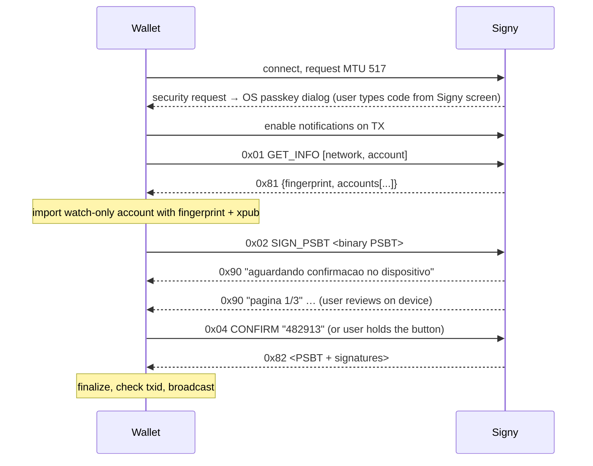

# Signy Protocol v1 — integrating the PokeSigner/Signy hardware signer into any wallet

> 🇧🇷 Guia aberto para qualquer carteira Bitcoin (Android, iOS, desktop ou web) usar o
> assinador **Signy / PokeSigner** via Bluetooth LE. O texto está em inglês para facilitar a
> adoção por outros projetos.

Signy is an open-source DIY Bitcoin signer for ESP32-C6 / ESP32-C3 boards with a screen
(firmware and web installer: <https://github.com/FelipeCOjeda/PokeSigner>). It keeps the BIP39 seed,
receives **PSBTs over Bluetooth LE**, shows every output on its own screen and only signs after the
user approves **on the device**. This document is everything a wallet needs to support it.

| | |
|---|---|
| Transport | Bluetooth LE, one GATT service, LE Secure Connections + MITM (6-digit passkey on the device screen) |
| Payload | Framed binary messages, any size up to 32 KB (16 KB on ESP32-C3) |
| Accounts | single-sig **BIP84** (P2WPKH, `bc1q…`) and **BIP86** (P2TR key path, `bc1p…`), mainnet and testnet |
| Signing | **PSBT v0** (BIP174 / BIP371). Returns the same PSBT plus signatures; the wallet finalizes and broadcasts |
| Approval | On the device: hold the button 2 s, **or** type in the wallet the 6-digit one-time code shown on the device screen |

---

## 1. Transport (BLE GATT)

| Item | UUID | Properties |
|---|---|---|
| Service | `50530001-b5a3-f393-e0a9-50ca5e1d0001` | primary, present in the advertisement |
| RX (wallet → signer) | `50530002-b5a3-f393-e0a9-50ca5e1d0001` | write, write-without-response; **encrypted + authenticated (MITM) link required** |
| TX (signer → wallet) | `50530003-b5a3-f393-e0a9-50ca5e1d0001` | notify (read is encrypted/authenticated and returns nothing useful) |

- **Discovery**: scan with a filter on the service UUID. Advertised names are `PS-XXXX`
  (advertisement) and `PokeSigner-XXXX` (scan response); don't rely on the name.
- **MTU**: request 517. Split writes into `MTU − 3` bytes (max 512). The signer splits notifications the same way.
- **Pairing/bonding**: the signer is *DisplayOnly*. On first connection it requests security; the OS
  shows a passkey dialog and the user types the **6 digits displayed on the signer**. Legacy pairing is
  disabled. Writes before the link is authenticated fail with *insufficient authentication*: wait for
  the bond and retry. Bonds persist on both sides; if the device was re-flashed, the user must "forget"
  it in the phone's Bluetooth settings.
- **One request at a time.** While a request is pending, only the control commands of §4 are accepted;
  anything else gets `0xFF "ocupado"`.
- Enable notifications on TX **before** sending the first request.

## 2. Framing

Both directions use the same frame:

```
+--------+----------------------+-----------------+
| cmd 1B | length 4B little-end | payload (length)|
+--------+----------------------+-----------------+
```

A frame may be split across any number of writes/notifications. Receivers buffer until
`5 + length` bytes have arrived. Multiple frames can arrive back to back.

## 3. Commands

| Request | Payload | Responses |
|---|---|---|
| `0x01` GET_INFO | `[network:1][account:4 LE]`, both optional. network 0 = main, 1 = test; account default 0 | `0x81` JSON (UTF-8) |
| `0x02` SIGN_PSBT | raw **binary** PSBT (not base64) | zero or more `0x90`, then `0x82` signed PSBT **or** `0xFF` error |
| `0x03` PING | — | `0x83` text, e.g. `PokeSigner 0.6.3 fp=94f97265` |

| Response | Payload |
|---|---|
| `0x81` INFO | JSON, see §3.1 |
| `0x82` SIGNED | binary PSBT |
| `0x83` PONG | ASCII text: name, version, master fingerprint |
| `0x90` STATUS | ASCII text, **informational only**: never ends a request |
| `0xFF` ERROR | ASCII text (Portuguese, human readable): show it to the user |

> ⚠️ The most common integration bug is treating the first `0x90` as the answer to SIGN_PSBT.
> Keep reading until `0x82` or `0xFF`.

### 3.1 GET_INFO

```json
{
  "fingerprint": "94f97265",
  "network": "main",
  "accounts": [
    { "type": "wpkh", "path": "m/84h/0h/0h", "xpub": "xpub6Bn…",
      "receive": "wpkh([94f97265/84h/0h/0h]xpub6Bn…/0/*)#cweuuy9n",
      "change":  "wpkh([94f97265/84h/0h/0h]xpub6Bn…/1/*)#f6uap34t" },
    { "type": "tr", "path": "m/86h/0h/0h", "xpub": "xpub6DB…",
      "receive": "tr([94f97265/86h/0h/0h]xpub6DB…/0/*)#n4vprnes",
      "change":  "tr([94f97265/86h/0h/0h]xpub6DB…/1/*)#zpfq7xfg" }
  ]
}
```

- Testnet uses `tpub` and coin type `1h`.
- `receive`/`change` are standard output descriptors with checksum (BIP380). Wallets that
  speak descriptors can import them directly; others use `fingerprint` + `path` + `xpub`.
- **Keep the real master fingerprint.** The signer only signs inputs whose derivation carries
  its fingerprint. An xpub-only import (fingerprint `00000000`) will be refused.

### 3.2 SIGN_PSBT: what the signer requires

Only **PSBT v0** is accepted (no `PSBT_GLOBAL_VERSION ≠ 0`). Per input the signer should sign:

| Script | Required fields |
|---|---|
| P2WPKH | `PSBT_IN_WITNESS_UTXO` (0x01) and `PSBT_IN_BIP32_DERIVATION` (0x06) with the signer's fingerprint. `PSBT_IN_NON_WITNESS_UTXO` (0x00) is optional; when present, its txid and amount are verified |
| P2TR key path | `PSBT_IN_WITNESS_UTXO`, `PSBT_IN_TAP_BIP32_DERIVATION` (0x16) with **zero** leaf hashes and the signer's fingerprint, and `PSBT_IN_TAP_INTERNAL_KEY` (0x17). `PSBT_IN_TAP_MERKLE_ROOT` (0x18) is honoured if present |

Rules:
- If any input is P2TR, **every** input must carry its UTXO (BIP341 hashes all amounts and scripts).
- Sighash: absent or `SIGHASH_ALL` (P2WPKH); absent, `SIGHASH_DEFAULT` or `SIGHASH_ALL` (P2TR). Anything else is refused.
- The signer re-derives every key and checks it against the script; mismatches are refused.
- Inputs that don't belong to the signer (fingerprint differs) are left untouched, so
  multi-party/coinjoin-style PSBTs work as long as at least one input is ours.
- **Change detection**: an output is shown as "change" only if it carries
  `PSBT_OUT_BIP32_DERIVATION` (0x02) or `PSBT_OUT_TAP_BIP32_DERIVATION` (0x07, zero leaves) for the
  signer's fingerprint **and** the derived key matches the output script. Every other output is shown as
  a destination with its full address and amount.
- The fee is shown when every input has a UTXO. High fees (> 10 % of the amount sent or > 0.01 BTC) are flagged.

### 3.3 SIGN_PSBT: what comes back

The **same PSBT bytes** with signatures appended to each input the signer owns:

| Script | Field added |
|---|---|
| P2WPKH | `PSBT_IN_PARTIAL_SIG` (0x02): key = `0x02‖pubkey(33)`, value = DER signature ‖ `0x01` |
| P2TR | `PSBT_IN_TAP_KEY_SIG` (0x13): 64-byte Schnorr signature (65 with a trailing `0x01` when the input requested `SIGHASH_ALL`) |

The wallet then **finalizes** (P2WPKH witness `[sig, pubkey]`, P2TR witness `[sig]`), checks the
txid against the one it built, and broadcasts. The signer never broadcasts and never needs network access.

### 3.4 Errors (`0xFF`)

Show the text to the user. Current messages (Portuguese) include:

| Text (prefix) | Meaning |
|---|---|
| `nenhuma entrada pertence a esta seed: PSBT e da carteira X, este signer e Y` | wrong seed/passphrase, or the PSBT came from another wallet |
| `nenhuma entrada pertence a esta seed: PSBT sem fingerprint …` | xpub-only import: re-import with the real fingerprint |
| `derivacao nao confere com o script` | derivation data doesn't match the UTXO script |
| `UTXO ausente/inconsistente` | missing UTXO (P2TR) or non_witness_utxo/witness_utxo mismatch |
| `recurso nao suportado …` | PSBT v2, unsupported sighash or script |
| `rejeitado no dispositivo` | the user rejected |
| `tempo esgotado` | no decision within 2 minutes, or the link dropped |
| `ocupado` | another request is still pending |
| `PSBT veio em base64 …` | send the decoded bytes |

## 4. On-device review and remote control

After a valid SIGN_PSBT the signer shows the pages: summary → one page per destination → change
→ **confirm**. The confirm page displays a fresh random **6-digit code**. The user approves by:

1. holding the device button for 2 s on the last page, **or**
2. typing that code in the wallet, which sends CONFIRM.

While SIGN_PSBT is pending the wallet may send these control frames (no reply of their own):

| Command | Payload | Effect |
|---|---|---|
| `0x04` CONFIRM | 6 ASCII digits | approve, only on the last page. 3 wrong codes reject the PSBT |
| `0x05` CANCEL | — | reject |
| `0x06` NEXT | — | next page |
| `0x07` PREV | — | previous page |

The signer reports progress with `0x90` (`"pagina 2/4"`, `"pagina 4/4: digite o codigo da tela para aprovar"`,
`"codigo incorreto (1 de 3)"`, …). **The wallet never learns the code**: the user reads it on the
device. That keeps approval safe even if the phone is compromised. Do not offer to remember or autofill it.
Boards without a screen accept only the physical button.

Recommended UI while waiting: the status text, ◀ ▶ ✖ buttons and a 6-digit numeric field with an
"Approve" button. The final `0x82`/`0xFF` arrives as the response to SIGN_PSBT.

## 5. Sequence



## 6. Reference clients

### Python (desktop, `pip install bleak`)
A complete CLI is in [`tools/client.py`](tools/client.py): `ping`, `info [--testnet]`, `sign file.psbt` (with keyboard remote control).

### Web Bluetooth (Chrome/Edge desktop & Android)
```js
const SVC = "50530001-b5a3-f393-e0a9-50ca5e1d0001",
      RX  = "50530002-b5a3-f393-e0a9-50ca5e1d0001",
      TX  = "50530003-b5a3-f393-e0a9-50ca5e1d0001";

const dev = await navigator.bluetooth.requestDevice({ filters: [{ services: [SVC] }] });
const svc = await (await dev.gatt.connect()).getPrimaryService(SVC);
const rx = await svc.getCharacteristic(RX), tx = await svc.getCharacteristic(TX);

let buf = new Uint8Array(0); const waiters = [];
tx.addEventListener("characteristicvaluechanged", e => {
  const chunk = new Uint8Array(e.target.value.buffer);
  const n = new Uint8Array(buf.length + chunk.length); n.set(buf); n.set(chunk, buf.length); buf = n;
  while (buf.length >= 5) {
    const len = new DataView(buf.buffer, buf.byteOffset + 1, 4).getUint32(0, true);
    if (buf.length < 5 + len) break;
    const frame = { cmd: buf[0], data: buf.slice(5, 5 + len) }; buf = buf.slice(5 + len);
    if (frame.cmd === 0x90) { console.log("signer:", new TextDecoder().decode(frame.data)); continue; }
    waiters.shift()?.(frame);
  }
});
await tx.startNotifications();

async function request(cmd, payload = new Uint8Array(0)) {
  const f = new Uint8Array(5 + payload.length);
  f[0] = cmd; new DataView(f.buffer).setUint32(1, payload.length, true); f.set(payload, 5);
  for (let i = 0; i < f.length; i += 180) await rx.writeValueWithResponse(f.slice(i, i + 180));
  const r = await new Promise(res => waiters.push(res));
  if (r.cmd === 0xFF) throw new Error(new TextDecoder().decode(r.data));
  return r.data;
}
const control = (cmd, payload = new Uint8Array(0)) => {          // 0x04..0x07, no reply
  const f = new Uint8Array(5 + payload.length); f[0] = cmd;
  new DataView(f.buffer).setUint32(1, payload.length, true); f.set(payload, 5);
  return rx.writeValueWithResponse(f);
};

const info = JSON.parse(new TextDecoder().decode(await request(0x01, new Uint8Array([0, 0, 0, 0, 0]))));
// const signed = await request(0x02, psbtBytes);  // meanwhile: control(0x04, new TextEncoder().encode("482913"))
```
(Web Bluetooth has no MTU API: 180-byte writes are a safe size. The OS pairing dialog appears on the first encrypted write.)

### Android (Kotlin) outline
- `BluetoothLeScanner` with `ScanFilter.setServiceUuid(ParcelUuid(SVC))`.
- `connectGatt(ctx, false, cb, TRANSPORT_LE)` → `requestMtu(517)` → `discoverServices()`.
- If `bondState != BOND_BONDED`: `createBond()` and wait for `ACTION_BOND_STATE_CHANGED == BOND_BONDED`.
- Write the CCCD (`0x2902`) of TX with `ENABLE_NOTIFICATION_VALUE`.
- **One GATT write at a time**: wait for `onCharacteristicWrite` before the next chunk. On API 33+ use the
  `writeCharacteristic(ch, bytes, WRITE_TYPE_DEFAULT)` overload and the 3-argument `onCharacteristicChanged`.
- Permissions: Android 12+ `BLUETOOTH_SCAN` (`neverForLocation`) + `BLUETOOTH_CONNECT`; Android ≤ 11
  `ACCESS_FINE_LOCATION` (location services on).
A full step-by-step for an Android wallet is in [`INTEGRACAO-POKEWALLET.md`](INTEGRACAO-POKEWALLET.md).

### iOS (Swift/CoreBluetooth) outline
- `centralManager.scanForPeripherals(withServices: [CBUUID(string: SVC)])`.
- `connect` → `discoverServices([SVC])` → `discoverCharacteristics([RX, TX])` → `setNotifyValue(true, for: tx)`.
- iOS negotiates the MTU itself: chunk writes by `peripheral.maximumWriteValueLength(for: .withResponse)`.
- The pairing alert appears automatically on the first write to the encrypted RX characteristic.
- Add `NSBluetoothAlwaysUsageDescription` to `Info.plist`.

## 7. Integration checklist

- [ ] Scan filtered by the service UUID; handle "Bluetooth off" and missing permissions.
- [ ] MTU 517 (or the platform maximum), notifications enabled before the first request.
- [ ] Frame reassembly across notifications; several frames per notification.
- [ ] `0x90` shown but never treated as the final answer; ≥ 3 min timeout for SIGN_PSBT.
- [ ] Import keeps the **real fingerprint** (`[fp/path]xpub` or the descriptors from GET_INFO).
- [ ] PSBT v0 with `witness_utxo` (+ `non_witness_utxo` for P2WPKH if available), derivations with the fingerprint, change derivations.
- [ ] P2TR: UTXO on every input; `PsbtTaproot` parser reads `0x13`.
- [ ] Finalize, compare the txid with the unsigned one, then broadcast.
- [ ] Remote approval UI: status, ◀ ▶ ✖, 6-digit code field, no autofill of the code.
- [ ] Show `0xFF` texts verbatim; offer "try again".

## 8. Testing without a wallet

- **nRF Connect** (Android/iOS): connect, enable notify on `…0003`, write the bytes `0300000000` to `…0002`
  → you get `PokeSigner … fp=…`.
- **Python**: `python3 tools/client.py info` / `sign tx.psbt`.
- **Firmware unit tests** (PC, compared against `embit`): `host_test/` in this repository.

## 9. Security model (what a wallet can and cannot do)

- The seed never leaves the device. The wallet only sees xpubs and signatures.
- Every destination, amount, fee and the change verification are shown **on the device**; the
  wallet cannot approve on its own (button or one-time code read from the screen).
- BLE requires an authenticated LE Secure Connections bond; only bonded wallets can write.
- Out of scope: physical attacks on the ESP32 (enable Flash Encryption + Secure Boot for that),
  multisig, script-path spends, PSBT v2, Lightning/Spark signing.

## 10. Versioning

This is **protocol v1**. `PING` returns the firmware version; new commands will only be added with new
codes, and existing frames keep their meaning. Wallets should ignore unknown response codes.
